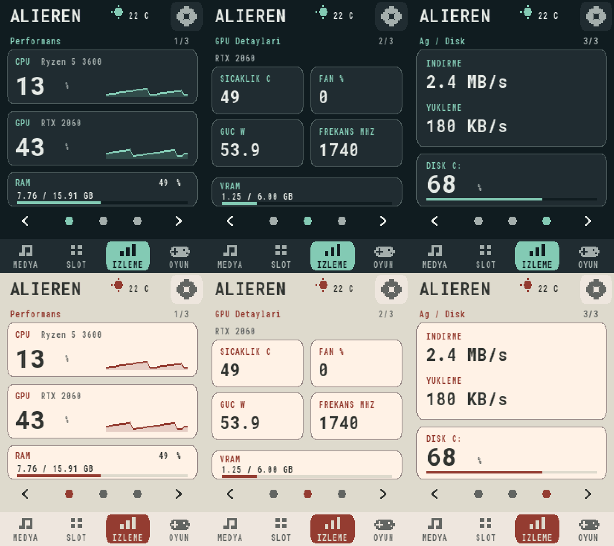

# Mini Deck — LPC1768 Desktop Controller


A touchscreen desktop controller built around the LPC1768 Mini-DK2 development board. The firmware handles touch input, display rendering and persistent settings, while a Windows companion manages application shortcuts, hardware monitoring, Discord controls and PUBG match reports.



*Rendered from the actual ARM firmware with sample values. Physical panel colors may differ.*

---

## Overview

Mini Deck connects to the PC through the board's **USB-COM** port. It provides six media controls and eighteen application slots across three pages. Profiles and icons are transferred over a checked serial protocol; changing a shortcut does not require rebuilding the firmware.

The desktop interface is currently in Turkish. The source documentation and code comments are in English.

## Features

### Desktop Control

- **18 Application Slots**: Three pages of six buttons with application selection, Steam shortcuts and automatic icons.
- **Media Controls**: Play/pause, previous/next track, volume and mute.
- **Profile Editor**: Drag-and-drop ordering, custom icons and profile import/export.
- **System Tray**: Optional background operation when the main window is closed.
- **Firmware Upload**: Integrated ISP uploader with package integrity and read-back verification.

### Monitoring & Integrations

- **Performance**: CPU/GPU model and utilization, RAM usage and touch-accessible history graphs.
- **GPU Details**: NVIDIA temperature, fan percentage, power, core clock and VRAM usage.
- **Network & Disk**: Transfer rates and system-drive usage.
- **Weather**: Optional Open-Meteo conditions with a selectable city/district.
- **Discord**: Microphone shortcut, application audio controls and voice-channel mute/deafen indicators.
- **PUBG**: Completed-match summaries, team kills/assists/damage and recent match reports.
- **FPS Service**: PresentMon supplies supported foreground-application frame data to the desktop/game views; the three-page monitor layout focuses on the selected hardware metrics.

### Firmware

- **Two Themes**: Graphite & Mint and Warm Stone, with optional time-based switching.
- **Display Power**: Adjustable brightness, inactivity dimming and touch-to-wake.
- **Partial Redraw**: Only changed text, values or graph regions are transferred to the display.
- **Persistent Settings**: CRC-checked preferences and touch calibration in reserved flash sectors.
- **Bounded Communication**: CRC16 frames, acknowledgements and duplicate-event protection.

---

## Hardware Requirements

| Component | Specification | Purpose |
|-----------|---------------|---------|
| Development board | LPC1768 Mini-DK2 | Cortex-M3 controller |
| Touchscreen | HY28A-compatible 240 × 320 panel | Display and resistive touch |
| USB connection | Board USB-COM / CP210x | Serial communication and ISP |
| Host | Windows PC, Python 3.11+ | Companion application |
| GPU telemetry | Supported NVIDIA driver with NVML | Extended GPU sensors |

Development and tests were performed on Windows with Python 3.14 and Arm GNU Toolchain 14.3.Rel1. Other Python versions and panel variants have not been physically verified.

Use the **USB-COM** connector, not the separate USB host/device connector. Install the CP210x driver if Windows does not expose a serial port. Ethernet is not used by this firmware.

See [hardware notes](docs/HARDWARE.md) for manufacturer references and enclosure information.

## Software Architecture

```text
Mini-Deck/
├── src/                    # Bare-metal firmware, drivers and UI
├── companion/              # Windows application and integrations
│   ├── firmware/           # Matching BIN + integrity manifest
│   └── actions.example.json # Portable default profile
├── tests/                  # Python tests and ARM emulation
├── tools/                  # Build, ISP, font and enclosure utilities
├── third_party/             # Redistributable font and license
├── docs/                   # Architecture, hardware and CAD files
├── lpc1768.ld              # Flash/RAM layout and stack assertion
├── start-deck.ps1          # Companion launcher
├── build.ps1               # Firmware build entry point
└── LICENSE
```

The firmware never receives shell commands or executable paths. Touch events contain slot IDs; the PC resolves those IDs against the locally configured profile. See [architecture and protocol](docs/ARCHITECTURE.md).

---

## Installation

### Start the Companion

1. Download this repository and extract it to a writable folder.
2. Install Python with Tkinter and add it to `PATH`.
3. Connect the board through USB-COM.
4. Run:

```powershell
.\start-deck.ps1
```

The launcher creates `.venv` and installs missing dependencies. On first use, the application creates `companion/actions.json` from the example profile: six media buttons and eighteen empty application slots. Personal settings, credentials and icons are excluded from version control.

To inspect the interface without opening a serial connection or executing shortcuts:

```powershell
.\start-deck.ps1 -Preview -DryRun
```

### Upload Firmware

1. Select the correct COM port in the application.
2. Open **Karta yazılım yükle**.
3. Hold **ISP**, press and release **RESET**, then release **ISP**.
4. Start the upload and wait for verification to complete.

The uploader checks the bundled image and source digest before writing. Preferences and calibration use reserved sectors. If touch calibration is missing, hold both board keys for approximately 1.2 seconds and follow the targets.

### Build from Source

Install **Arm GNU Toolchain** (`arm-none-eabi-gcc`) and add its `bin` folder to `PATH`, or extract the Windows toolchain under `tools/arm/`.

```powershell
python -m venv .venv
.venv\Scripts\python.exe -m pip install -r tests\requirements.txt
.venv\Scripts\python.exe tools\build.py
.venv\Scripts\python.exe -m unittest discover -s tests -q
```

The build generates BIN/HEX/ELF files and updates `companion/firmware/mini-deck.bin` together with its SHA256/source manifest. Rebuild after editing firmware sources, including comments.

To regenerate the open-license font atlas:

```powershell
.venv\Scripts\python.exe tools\build_ui_font.py
.venv\Scripts\python.exe tools\build.py
```

## Usage

| Control | Action |
|---------|--------|
| Bottom navigation | Media, slots, monitoring or game panel |
| Page arrows/dots | Switch the current group of pages |
| CPU/GPU/RAM card | Open the usage history graph |
| Settings icon | Theme, brightness, sleep and automatic theme |
| First touch after sleep | Wake only; a second touch activates controls |
| Tray → Tamamen çık | Fully stop the companion |

Configure optional integrations from the PC settings:

- **Discord**: Add your bot, choose a voice channel, configure a microphone shortcut and select your own account for accurate microphone state. The bot reads roster state; it does not join voice or detect who is speaking. Deafen state is not physical speaker power.
- **PUBG**: Supply your own API key and Steam player name. Reports describe completed matches, not live enemy positions or live match statistics.
- **Weather**: Search and select a location, then enable display. Requests run in the background every ten minutes; unavailable or expired data is shown as missing.

## Limitations & Validation

The public source build passes **107 automated tests**, including ARM rendering/protocol tests and first-launch profile creation.

- GPU sensors depend on NVML/driver support. Fan output is a **percentage**, not RPM. CPU temperature and case/CPU fan speed are not implemented.
- Missing sensor data is displayed as `--`, never as a fabricated zero.
- Sensor values shown in screenshots are examples. ARM emulation tests verify logic/rendering, not physical LCD timing, color accuracy or wiring.
- Settings containing API tokens are protected with Windows DPAPI, but must still remain private and outside the repository.
- The public firmware uses **Roboto Mono**, licensed under SIL OFL 1.1, instead of a Windows system-font atlas.
- Enclosure dimensions originate from the 95 × 78 mm board and photo-based measurements. Print a fit check before committing to all parts; bezel v1 needs physical fit confirmation.

---

## Sharing the Project

The release copy includes source code, portable defaults, matching firmware, documentation and enclosure geometry. It excludes local account settings, cached profiles, backups and build tools. To recreate the upload ZIP after rebuilding:

```powershell
.venv\Scripts\python.exe tools\package_release.py
```

Upload the **contents** of the extracted `Mini-Deck` folder to your new GitHub repository. Use `.gitignore` when working from a clone; never upload your original personal working folder wholesale.

## License

Project-authored code and enclosure designs are licensed under the [MIT License](LICENSE). Third-party components retain their own licenses; see [Third-Party Notices](THIRD_PARTY_NOTICES.md).

Developed & maintained by **Ali Eren Safi**.
